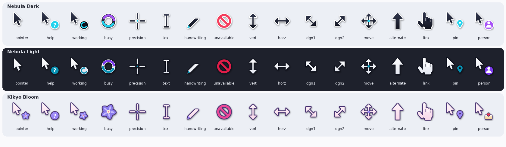

# Nebula Cursor Pack

Modern, kenarlıkları yumuşak, gölgeli bir fare imleci paketi. Üç tema içerir:

- **Nebula Dark**: koyu gövde, beyaz kenarlık, camgöbeği/mor vurgular
- **Nebula Light**: beyaz gövde, koyu kenarlık
- **Kikyo Bloom**: pastel pembe/lavanta; ok imlecinde çan çiçeği (kikyo), meşgul imlecinde dönen çiçek, "kişi" imlecinde çilekli pasta dilimi



17 imlecin hepsi var (Normal, Yardım, Arka planda çalışıyor, Meşgul, Hassas seçim, Metin,
El yazısı, Kullanılamaz, 4 yeniden boyutlandırma, Taşı, Alternatif, Bağlantı, Konum, Kişi).
"Meşgul" ve "Arka planda çalışıyor" animasyonludur (`.ani`). Her imleç 32, 48, 64, 96 ve
128 px boyutlarını içerir, yani Windows'taki imleç boyutu ayarında da net görünür.

## Windows'a kurulum

1. `dist/windows/NebulaDark` (veya `NebulaLight`) klasörünü açın.
2. `install.inf` dosyasına sağ tıklayın → **Yükle** (Windows 11'de önce "Diğer seçenekleri göster").
3. Fare Özellikleri penceresi açılır: **İşaretçiler** sekmesinde düzen olarak **Nebula Dark**'ı
   seçin → **Uygula**.

## Linux'a kurulum

```bash
mkdir -p ~/.icons && cp -a dist/linux/NebulaDark ~/.icons/
```

Ardından masaüstü ortamınızın görünüm ayarlarından (GNOME Tweaks, KDE Sistem Ayarları vb.)
imleç temasını **Nebula Dark** yapın.

## Yeniden oluşturma / renkleri değiştirme

Bütün imleçler `build.py` ile koddan çizilir. Renkleri `VARIANTS` içinden değiştirip:

```bash
python3 build.py
```

(Pillow gerekir: `pip install pillow`.)
