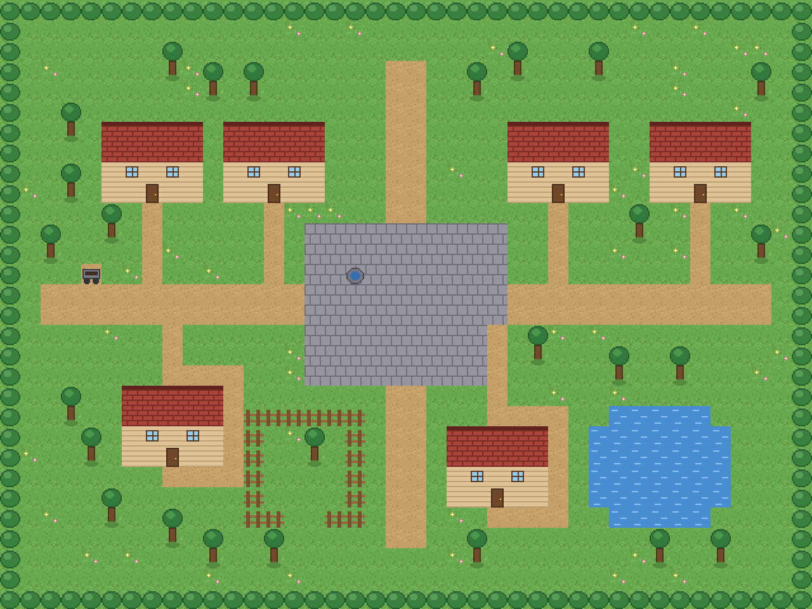

# Çınarköy — Stardew Valley için yeni köy modu

Stardew Valley **1.6+** için bir [Content Patcher](https://www.nexusmods.com/stardewvalley/mods/1915)
içerik paketi. Oyuna vagonla (minecart) gidilen yeni bir köy haritası ekler.
C# gerekmez; her şey JSON + Tiled haritası.



## Kurulum

1. [SMAPI](https://smapi.io) ve Content Patcher'ı kur.
2. `[CP] Cinarkoy` klasörünü oyunun `Mods` klasörüne kopyala.
3. Oyunu SMAPI ile başlat.

## Köye gitmek

- **Oyun içinden:** herhangi bir vagona tıkla, listeden *Çınarköy*'ü seç.
  (Vagonların açık olması gerekir: Topluluk Merkezi kazan dairesi ya da Joja.)
- **Test için:** SMAPI konsoluna şunu yaz:

  ```
  debug warp TahaAkhan.Cinarkoy_Koy 4 14
  ```

Dönüş için köydeki vagona tıkla.

## Dosyalar

| Dosya | Ne işe yarar |
|---|---|
| `[CP] Cinarkoy/manifest.json` | Modun kimliği |
| `[CP] Cinarkoy/content.json` | Konum kaydı, vagon durağı, harita yüklemesi |
| `[CP] Cinarkoy/assets/Cinarkoy.tmx` | Köy haritası ([Tiled](https://www.mapeditor.org) ile düzenlenir) |
| `[CP] Cinarkoy/assets/cinarkoy_tiles.png` | Özgün 16×16 karo seti |
| `[CP] Cinarkoy/i18n/` | Çeviriler (`default.json` İngilizce, `tr.json` Türkçe) |
| `tools/harita_uret.py` | Başlangıç haritasını ve karo setini üreten betik |

## Haritayı düzenlemek

`Cinarkoy.tmx` dosyasını Tiled ile aç. Katman adları oyun için anlamlıdır, değiştirme:

- `Back` — zemin (üzerinde yürünür)
- `Buildings` — engeller (duvar, çit, ağaç gövdesi)
- `Front` — oyuncunun önünde çizilenler (ağaç tepeleri)

Vagonun (4, 13) ve varış karosunun (4, 14) yerini değiştirirsen `content.json`
içindeki koordinatları da güncelle. Haritayı elle düzenlemeye başladıktan sonra
`tools/harita_uret.py` betiğini tekrar çalıştırma; haritanın üzerine yazar.

## Sırada ne var

- Evlerin içleri (her ev için ayrı harita + kapı `Warp`'ları)
- Köylüler (`Data/Characters`, portre ve sprite çizimleri, diyaloglar, programlar)
- Dükkân (`Data/Shops`)
- Vadi'den yürüyerek giriş (vanilla bir haritaya `AddWarps`)
- Dünya haritasında köyün görünmesi (`Data/WorldMap`)
